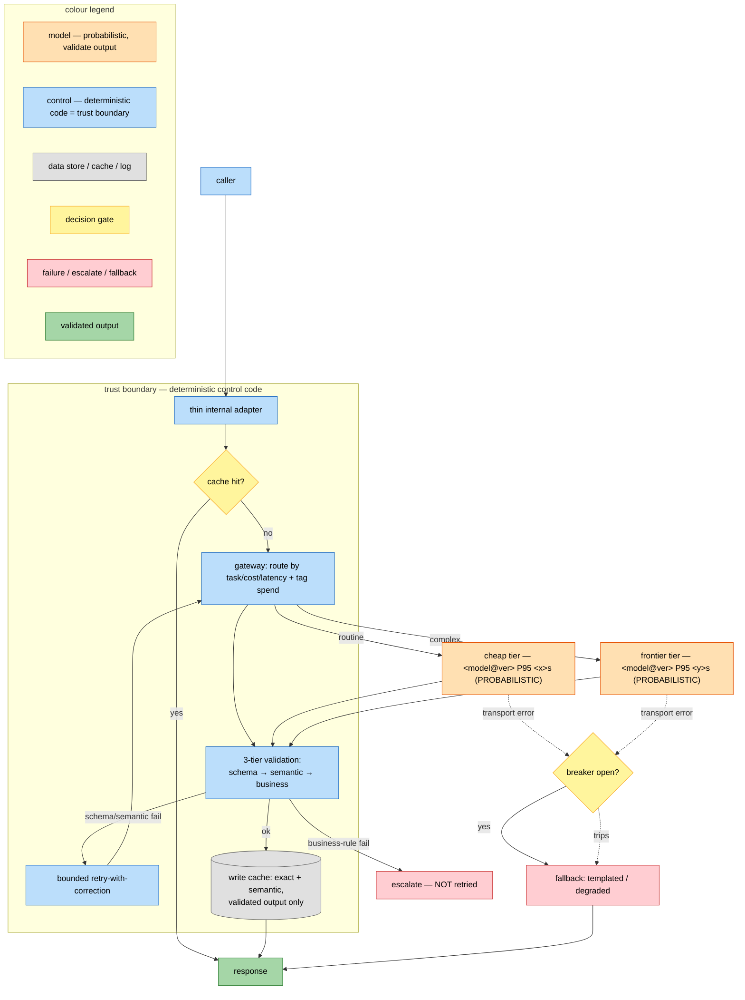

# Integration Architecture

Design the layer between the application and the model(s): one gateway every AI call passes through,
safe handling of probabilistic output, the non-functional targets AI uniquely needs, and an explicit
fallback for every touchpoint. Consumes `system-architecture` / `model-selection`; produces
`docs/integration-<component>.md`.

## 1. The AI integration layer (gateway + adapter)
A single point every AI call passes through, so callers never hardcode a provider:
- routes by task / latency / cost tier / segment; model behind a stable API swappable **by config, not
  code** (including a move to self-hosted);
- per-caller rate limits (one noisy service can't starve shared inference);
- tags every call with cost-centre / feature / user metadata for after-the-fact spend breakdown;
- centralises caching (exact-match, semantic, prompt-prefix) and full-context logging (input, output,
  version, tokens, latency, cost);
- callers talk to a **thin internal adapter**, not the gateway API directly, so a gateway migration
  touches one file. The gateway is a **role** — the single chokepoint for keys, routing, cost attribution,
  rate limits, caching, and guardrail *hooks* — not a product. Common fills by context: **LiteLLM** (OSS,
  multi-provider / on-prem), **Azure APIM's GenAI-gateway** pattern (Azure-native), Portkey / Kong / Cloudflare
  AI Gateway. The pattern matters more than the tool. Do **not** conflate the gateway with the **guardrail
  engine** (Llama Guard, NeMo, Azure AI Content Safety) — the gateway is a good place to *run* guardrails, not
  a substitute for them. Running it for guardrails only is a legitimate slice; the other features are there
  when a second model, team, or budget appears.

## 2. Handle probabilistic output — constrain, validate, route
- **Constrain at the source:** JSON mode / tool-call structured output; version the output schema like an
  API contract.
- **Three-tier validation, cheapest first, stop at the first failure:** (1) schema conformance →
  (2) semantic sanity (plausible values) → (3) business-rule compliance (domain limits).
- **Route failures by case:** bounded retry-with-correction for schema/semantic faults; a
  deterministic/templated fallback when a degraded answer beats none; human escalation for high-stakes
  misses; an honest degraded-mode message for user-facing flows.
- **Retry only transient provider errors.** Never retry a business-rule failure or an auth error —
  escalate. (Database-style blind retry on an LLM call causes retry storms.)

## 3. AI-specific non-functional requirements
- Latency is a wide distribution, not a tight one: design and alert on **P95/P99, not the median**;
  stream first tokens for perceived speed; cap max output tokens as a latency lever.
- Cache aggressively: exact-match for repeats, semantic cache (threshold tuned empirically) for
  paraphrases, stable-content-first prompts for provider prefix caching.
- Batch non-interactive work; queue interactive bursts.
- Treat AI as a potential **single point of failure**: per-feature kill switches, a defined fallback per
  touchpoint, and **circuit breakers** that trip to the fallback before every request fails individually.

## 4. Data pipeline (if the component ingests data)
Six stages, each a real surface: source connectors → parse → preprocess/dedup → chunk → embed → index.
Freshness is chosen from an **SLA** (scheduled full / incremental diff / event-driven, rising
complexity), not the reverse. Multimodal content needs its own extraction path. **Lineage is mandatory**
(which chunk, source version, embedding model, timestamp fed each answer) for debugging, erasure, audit.

## 5. The integration document
Write `docs/integration-<component>.md`: system context (the AI capability + every existing system it
touches, modifiable vs frozen); an integration diagram (gateway/adapter placement, data-flow direction,
where human review / staging sits); the API/data contract (schema, versioning, auth); the three-tier
validation applied to *this* project's real failure modes; a fallback/degradation plan (one explicit
answer per touchpoint for "what happens when it fails"); non-functional targets (P95/P99 budget, caching
plan, throughput approach); the data/lineage plan; security/compliance notes (residency, PII, log
redaction); and the few monitoring metrics that would actually reveal failure (correction rate, cache-hit
rate, fallback-trigger rate).

## 5a. Integration diagram template (Mermaid) — emit it, matched to the prose
A diagram that disagrees with the text is worse than none: same component names, same tiers, same
fallbacks. Fill the placeholders; render it (Mermaid in `.md`; a graphviz PNG in a notebook). **Follow the
AI-diagram convention from `system-architecture` §5a**: colour-code by component kind *with a legend* (model/
probabilistic, deterministic control = the trust boundary, data, human, failure, gate), annotate each model
node with model + version + P95, mark the probabilistic nodes, and draw the trust boundary explicitly.
````

````
(`:::class` colours a node; the `legend` subgraph documents what each colour means; annotate every model node
with `model@version` + its P95 and mark it PROBABILISTIC. The notebook equivalent uses `arch_kit.dnode` /
`diagram_legend`, rendered to a PNG.)

## 6. When code is scaffolded
Reference code ships **secure-by-default and resilient-by-default**: the adapter interface (not raw
provider SDKs); structured-output enforcement + the three-tier validator; a circuit breaker and a defined
fallback; redaction before logging. It ships with **meaningful tests** (each a real behaviour + reason,
able to fail): the schema tier rejects malformed output; the business-rule tier rejects an out-of-range
but schema-valid value; a repeated request is served from cache; the circuit breaker trips to fallback
after the threshold; a business-rule failure is **not** retried. Never a coverage-only test.

## Anti-patterns to flag
Provider SDK calls embedded in application code (no adapter); prompting for JSON and hoping, with no
validator; no defined fallback for a touchpoint; database-style timeout/retry on LLM calls (retry
storms); tuning to median latency and ignoring the P95/P99 tail; defaulting every call to synchronous
regardless of its latency profile.

## Output and handoff
Write the document and any scaffolded code/tests, then a 3-line summary: the gateway/fallback shape, the
touchpoint most likely to fail silently, and the next step (usually `governance-review` then
`evaluation-design`).
