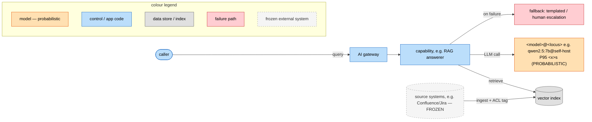
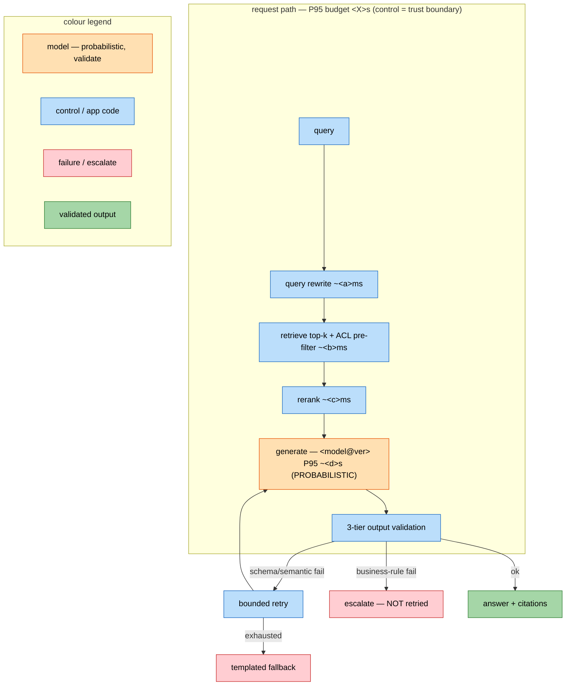
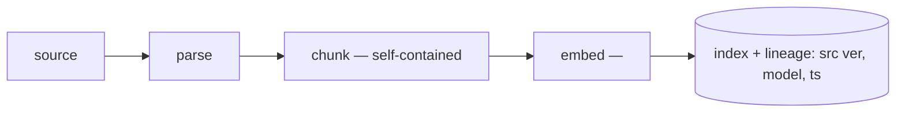
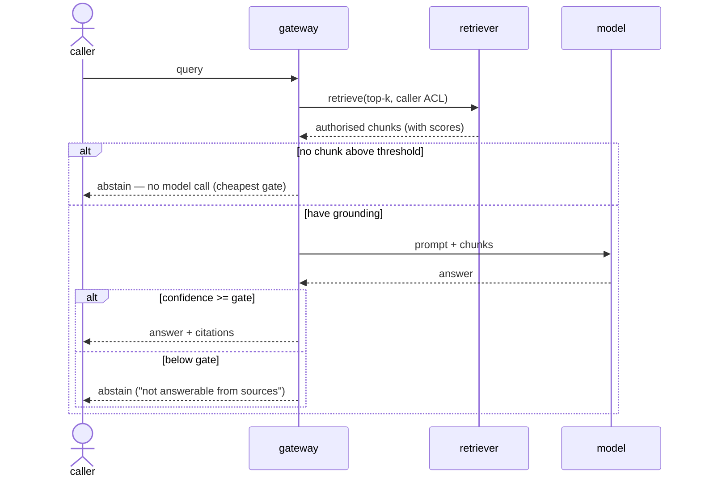

# AI System Architecture

Turn a scoped problem into a concrete, defensible architecture: the pattern, the stack, the failure
modes designed against, and the security/eval/cost budgets — then, for anything to be built,
secure-by-default reference code with meaningful tests and an evaluation harness. Consumes a
`scoping-document` (read its YAML front-matter) when one exists; feeds `model-selection`,
`governance-review`, and `evaluation-design`.

## 1. Choose the pattern(s) — name the trigger, not the fashion
Pick from the six core patterns and justify each against the scoped need, not because it sounds good:
- **Inference pipeline** — single-pass, stateless, bounded input/output (classify, tag, extract).
- **RAG** — needs knowledge not in training, available at query time.
- **Agentic loop** — multi-step, steps can't be fully pre-specified, needs external tool use.
- **Ensemble/router** — mixed request complexity; tier cheap vs frontier for cost.
- **Human-in-the-loop** — high-stakes/regulated, low error tolerance.
- **Multimodal** — the modality (vision/voice) is the task, with its own latency envelope.
A system is usually a composition. State which capability uses which pattern.

## 2. Design the RAG stack (if used), component by component
- **Ingestion:** parse → **chunk so every chunk is self-contained** (structure-aware where the source
  has structure; token-sized with overlap otherwise; always attach document/section context so a chunk
  does not lose a mid-sentence fact or what a pronoun refers to) → embed → vector store. Record source
  version + timestamp per chunk. (Avoid the absolutes in both directions: "never fixed-size" is as wrong
  as "always fixed-size" — the test is self-containment, measured on your data.)
- **Retrieval:** query rewrite (condense chat history to a standalone query — and treat it as an
  injection surface, since chat history is attacker-reachable) → embed with the *same* model as the
  corpus → **hybrid search** (dense + BM25 *with a real analyzer: stopwords + stemming*, fused with RRF).
  Dense embedders *vary* on opaque tokens — add BM25 and **measure the delta on your golden set** rather
  than assuming it; a strong embedder on a small clean corpus may show no gain → **cross-encoder rerank**
  (measure its latency/quality trade-off; skip only with a number) → context assembly → generation with
  explicit grounding.
- **Design against the production failure modes, by name:**
  - *coreference collapse* → contextual chunk enrichment.
  - *absence blindness* (no "I don't know") → a retrieval-confidence gate before generation.
  - *write-side neglect* (stale/duplicate chunks) → version tracking, event-driven re-ingestion, a
    staleness SLA.
- **High-stakes/citation-grade retrieval** (legal, medical, financial): standard RAG is insufficient —
  add citation verification and stronger reranking; say so explicitly.

## 3. Design the agent (if used)
- **ReAct** loop (reason→act→observe); tools **atomic and reversible-first** (read before write, soft
  delete, staging).
- **Memory tiers:** in-context / external short-term / external long-term / procedural — matched to real
  persistence needs, with **write gates** (explicit / confidence-gated / extract-then-store) so poisoned
  or low-quality facts never enter long-term memory. Under GDPR (and similar regimes), for personal
  data, TTL and an erasure index are legal requirements, not hygiene.
- **Multi-agent:** orchestrator-owns-state to start; treat every inter-agent message as **untrusted**.
- **Design against:** cost spirals (token/step budgets + alerts), non-determinism (version logging +
  deterministic post-processing + a human gate for high-stakes), context mismanagement (summarisation /
  retrieval / budgets + prompt/semantic/embedding caching).

## 4. Security section (always) — structural, not prompt-level
Retrieved content and tool output are an **attack surface** (indirect injection). Required controls,
enforced in code not the prompt:
- trust-tier / provenance labelling of all external content; segregate tiers and forbid untrusted
  content from triggering consequential actions;
- no consequential tool call in the same turn as freshly-ingested untrusted content;
- **least-privilege tools** (read-only connectors by default; a write/delete tool is a deliberate,
  gated decision);
- access control as a **query-time pre-filter** (never post-processing), with document-level ACLs —
  because a post-filter after top-k retrieval both loses recall and leaks ranking signal about docs the
  caller may not see;
- a **URL/domain allowlist** for any fetch tool, and **output sanitisation** against auto-rendering
  exfiltration (e.g. markdown images) — both are how the markdown-image exfil is killed;
- **ingestion-time scanning** for hidden instructions (white-on-white text, zero-width chars in PDFs);
- a **per-answer audit** of which chunk IDs fed each response, for debugging and incident blast-radius.
(These mirror the *measured* results in the companion `ai_security_labs` repo — e.g. `module05`
Lab 45: prompt-level boundary framing did **not** hold on a 7B; `gap_mcp_jira_injection`: a read-only
connector was compromised 0/3 while a deny-by-default approval gate held. Structure holds; prompts do not.)

## 5. The architecture document
Write `docs/architecture-<project-slug>.md` with: problem + chosen pattern(s) and why; a **context
diagram**, **component diagram** (annotate model versions + latency), **data-flow** and **sequence**
diagrams (use Mermaid); per-capability design with failure modes handled; access-control / multi-tenancy
model; freshness/staleness SLA; the security section; an evaluation plan (golden set, recall@k or
task/trajectory/safety metrics, where it attaches); a cost + latency budget (token ceilings, step
limits, circuit breakers); and explicit caveats (what the design simplifies, what needs legal review).

## 5a. Diagram templates (Mermaid) — emit these, don't just name them
Produce real diagrams, not a sentence saying "add a diagram". Mermaid renders on GitHub `.md`; **in a
notebook, render to an image** (graphviz PNG cell output — GitHub does not render Mermaid inside `.ipynb`).
AI architecture diagrams are **more explicit than normal ones** (the course's point):
- **Colour must carry meaning, with a legend.** One documented scheme: *model/LLM (probabilistic — validate
  its output)*, *deterministic control / app code (the trust boundary)*, *data store/index/log*, *human in
  the loop*, *failure/block/escalate*, *decision gate*. Never colour decoratively; always include the legend.
- **Annotate the AI-specific detail**: each model node with its model + version + P95 latency budget; mark
  which nodes are **probabilistic** (and therefore need validation); draw the **trust boundary** explicitly
  (what is enforced in code vs what the model merely proposes); label edges with the **failure mode** handled.
- **The diagram must match the prose**: same component names, model versions, and latency numbers — a diagram
  that disagrees with the text is worse than none. Fill the placeholders from *this* project; delete rows
  that don't apply. (Mermaid colour via `classDef` + `:::class`; in notebooks use the `arch_kit` `dnode` /
  `diagram_legend` helpers.)

**Context diagram** — the capability and every system it touches (mark frozen systems):
````

````

**Component diagram** — colour by kind, annotate model version + the P95 budget per step, mark the model probabilistic:
````

````

**Data-flow (ingestion)** and **sequence (one request, with the abstain gate)**:
````


````

## 6. When a component is to be built — the factory outputs
Do not stop at the document. Scaffold, to the project's language:
- **Secure-by-default reference code** for the component (e.g. a retrieval function with the query-time
  ACL pre-filter and trust-tiering already in place — security is the default, not a TODO).
- **A small set of meaningful tests** — each asserts a real behaviour, contract, or security property
  and carries a one-line rationale, and is written so it can actually fail. Examples worth their place:
  the exact-ID doc is retrievable through the **lexical path alone** (BM25 rank 1 with dense disabled —
  a falsifiable contract, unlike "hybrid beats dense" which is false when dense already ranks it #1); the
  confidence gate abstains on an **off-topic** query *and* its documented limitation is pinned (it does
  not catch on-topic-but-unanswerable — assert that so it can't silently regress into a false
  groundedness claim); a planted indirect-injection doc does **not** cause a tool call; an unauthorised
  caller never retrieves a restricted document. Never write a test whose only effect is to raise coverage,
  and never calibrate a threshold on the same examples you then assert on.
- **An eval harness** for the AI component: a small golden set and the metric that matters (recall@k for
  retrieval, groundedness/abstention for generation), runnable as a gate.

## Anti-patterns to flag
Chunks that aren't self-contained; vector-only retrieval where lexical signal matters; skipping rerank
without measuring it; ignoring the write/freshness side; unbounded agent loops; calibrating a threshold
on its own test set; treating the system prompt as the safety layer instead of application-layer
enforcement.

## Output and handoff
Write the document and any scaffolded code/tests/eval, then give a 3-line summary: the pattern chosen,
the one failure mode most likely to bite in production, and the next step (usually `model-selection`
then `evaluation-design`).
